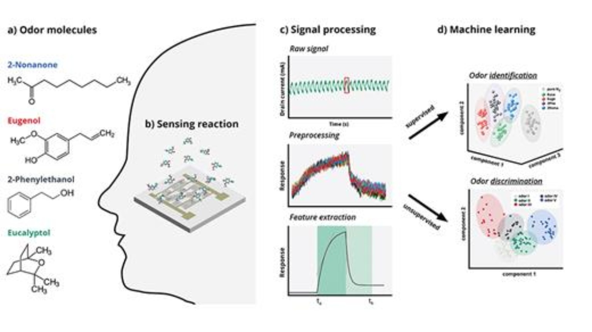

# 응용화학과 / 인공후각 기술

## 1. 인공후각 기술의 개념 소개

인공후각은 인간의 후각 시스템을 모방하여 기체에 포함된 화학물질을 감지하고 냄새를 식별하는 기술로 여러 화학 센서와 데이터 분석 기술을 결합하여 냄새의 종류와 특성을 판별한다. 특정 물질의 농도를 측정하는 기존의 분석 기술과는 달리 여러 휘발성 유기화합물이 만들어내는 복합적인 냄새 패턴을 분석하여 시료를 구별하는 것이 특징이다.

## 2. 인공후각 기술의 등장 배경

기존의 냄새 분석은 사람의 감각에 의존하거나 가스크로마토그래피-질량분석법(GC-MS) 등의 정밀 분석 장비를 활용했다. 그러나 사람의 후각은 주관적이고 쉽게 피로해지며, 정밀 분석 장비는 비용과 분석 시간 측면에서 제약이 있다. 이에 따라 냄새를 신속하고 객관적으로 측정할 수 있는 인공후각 기술이 발전하게 되었다.

## 3. 인공후각 기술의 핵심 메커니즘

그림6: 인공후각 시스템의 작동 원리
출처: AIP Publishing(2023), 「E-noses: Smells like the future of sensors」
원본: AIP Publishing 공식 홈페이지(https://pubs.aip.org/aip/sci/article/2023/20/201101/2890531/E-noses-Smells-like-the-future-of-sensorsGraphene)

인공후각은 냄새 감지 → 전기적 신호 변환 → 데이터 처리 → 패턴 인식의 과정으로 작동한다. 금속산화물 반도체(MOS) 등의 화학 센서는 기체 분자가 센서 표면에서 반응하면 전기저항이 변화하고, 각 센서는 물질에 따라 서로 다른 반응을 나타낸다. 이렇게 여러 센서에서 얻은 신호 데이터는 이후 AI 및 머신러닝 기법으로 분석된다. 이를 통해 어떤 냄새인지 구별하거나 식품의 신선도와 같은 상태를 예측할 수 있다.

## 4. 인공후각 기술의 응용분야

인공후각 기술은 다양한 산업 분야에서 활용되고 있다. 식품 분야에서는 육류의 신선도와 부패 여부를 판단하고, 의료 분야에서는 호흡 속 휘발성 물질을 분석하여 질병의 진단을 보조한다. 환경 분야에서는 유해가스 및 악취를 감지하며, 산업 현장에서는 가스 누출 감지와 제품 품질관리에 활용된다.

## 5. 인공후각 기술의 전망과 한계

### 인공후각 기술의 전망

인공후각은 AI와 나노소재 기술의 발전을 통해 더욱 소형화되고 정밀해질 것으로 기대된다. 특히 휴대용 진단기기와 실시간 모니터링 기술로서 활용 가능성이 높다. 또한 비파괴적 검사 방법이라는 점에서 그 의의가 크다.

### 인공후각 기술의 한계

인공후각 기술은 센서의 전기 저항 변화를 신호로 변환하는 만큼 온도와 습도에 따른 반응의 변화가 크다. 또한 장기간 사용에 따른 센서의 노화로 성능이 저하되며, 목적 기체가 아닌 다른 기체에도 교차 감응하기에 선택성이 떨어진다. 데이터 분석에 있어 AI가 필수적이기에 AI의 분석 정확도 또한 큰 변수이다. 따라서 센서의 안정성 확보와 선택성 향상 및 AI 모델의 신뢰성 확보가 중요한 연구 과제이다.

## 참고자료

- [MDPI (Sensors), Electronic Noses: From Gas-Sensitive Components and Practical Applications to Data Processing](https://doi.org/10.3390/s24154806⁠)
- [MDPI (Sensors), Applications and Advances in Electronic-Nose Technologies](https://doi.org/10.3390/s90705099⁠)