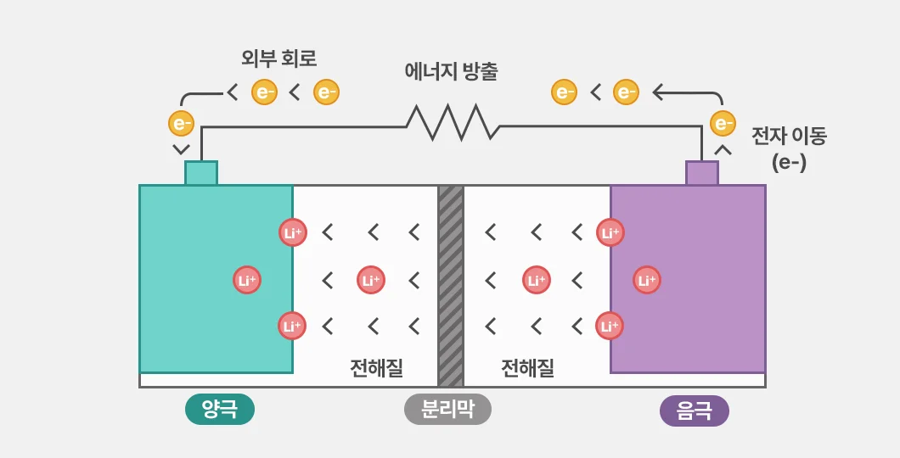
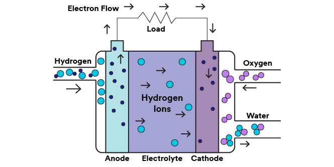

# 화학공학과 / 에너지 저장·변환 기술

## 1. 에너지 저장·변환 기술의 개념 소개  

### **에너지 저장 기술**이란?  

생산된 에너지를 저장하였다가 필요한 시점에 사용할 수 있도록 하는 기술이다. 에너지 생산과 소비 시점이 일치하지 않는 문제를 해결하여 안정적인 에너지 공급을 가능하게 한다.
### **에너지 변환 기술**이란?  

한 형태의 에너지를 다른 형태의 에너지로 변환하는 기술이다.  
대표적으로 **수소 연료전지**는 화학 에너지를 전기 에너지로 변환하여 전력을 생산한다.

## 2. 에너지 저장·변환 기술의 등장 배경  

### **기존 에너지 산업의 문제점**  

기존 에너지 산업은 석탄, 석유 등 화석연료를 중심으로 발전해왔다. 하지만 화석연료 사용은 온실가스 배출과 환경 문제를 발생시켜 친환경 에너지 기술 개발의 필요성을 증가시켰다.  
### **친환경 모빌리티 산업의 성장**  

전기차 산업의 성장으로 배터리는 주행거리와 성능을 결정하는 핵심 기술로 자리 잡았으며, 이는 에너지 저장 기술 발전을 촉진하는 계기가 되었다.

## 3. 에너지 저장·변환 기술의 핵심 메커니즘

### 리튬이온 배터리의 구조와 원리  

리튬이온 배터리는 **양극, 음극, 전해질, 분리막**으로 구성되며, 리튬 이온의 이동을 통해 충전과 방전이 이루어진다.
**양극**은 리튬 이온을 저장하고 방출하며 배터리의 용량과 전압에 영향을 준다.
**음극**은 충전할 때 리튬 이온을 저장하고 방전할 때 방출하는 역할을 한다.
**전해질**은 양극과 음극 사이에서 리튬 이온이 이동할 수 있는 통로를 제공한다.
**분리막**은 두 전극의 직접 접촉을 막아 내부 단락을 방지하면서 이온은 통과시킨다.  
**충전 시** 외부 전원에 의해 리튬 이온은 양극에서 음극으로 이동한다.  
**방전 시** 리튬 이온은 음극에서 양극으로 이동하며 저장된 에너지가 전기에너지로 공급된다. 이때 전자는 외부 회로를 통해 이동하며 전기차 모터 등의 장치에 전력을 공급한다.  
이해를 돕기 위해 아래와 같은 이미지와 표를 추가하였다.  

  
그림2: 리튬이온 배터리 구조  
출처: LG에너지솔루션, 「전기화학으로 이해하는 리튬이온배터리 작동 원리」, 배터리인사이드  
원본: [LG에너지솔루션 홈페이지](https://inside.lgensol.com/2026/04/전기화학으로-이해하는-리튬이온배터리-작동-원리/)

| 구분 | 충전 | 방전 |
|---|---|---|
| 리튬 이온 이동 | 양극 → 음극 | 음극 → 양극 |
| 에너지 흐름 | 외부 전력 저장 | 저장된 에너지 공급 |

### 수소연료전지 구조와 원리  

지금부터는 미래에 유망한 에너지 변환 기술인 수소연료전지에 대해 설명하겠다.  
수소연료전지는 수소와 산소의 전기화학 반응을 이용하여 화학에너지를 전기에너지로 변환하는 장치이며, **음극, 양극, 전해질, 외부 회로**로 구성된다.  
**음극**에서는 수소가 촉매의 도움을 받아 수소 이온과 전자로 분리된다. 분리된 전자는 **외부 회로**를 통해 양극으로 이동하며, 이 과정에서 전류가 발생한다. 수소 이온은 전해질을 통과하여 양극으로 이동한다.  
**전해질**은 전자의 이동은 막고 수소 이온의 이동을 돕는다.  
**양극**에서는 이동한 수소 이온과 전자, 산소가 반응하여 물을 생성한다.  
전체 반응은 ***2H₂ + O₂ → 2H₂O***로 나타낼 수 있으며, 이 과정에서 전기에너지와 열에너지가 발생한다.  
따라서, 수소연료전지는 배터리와 달리 연료가 지속적으로 공급되는 동안 전기를 생산할 수 있다는 특징이 있다.  
전체 과정의 이해를 돕기 위해 아래와 같은 이미지와 표를 추가하였다.  

  
그림3: 수소연료전지 구조  
출처: 한국쓰리엠(3M), 「수소 연료 전지의 기본 지식」  
원본: [3M 공식 홈페이지](https://www.3m.co.kr/3M/ko_KR/hydrogen-technology-kr/applications/fuel-cells/)  

| 과정 | 주요 내용 |
|---|---|
| 수소 분해 | 음극에서 수소 이온과 전자로 분리 |
| 전자 이동 | 외부 회로를 통해 전류 발생 |
| 이온 이동 | 전해질을 통해 양극으로 이동 |
| 산소 반응 | 양극에서 물 생성 |

## 4. 에너지 저장·변환의 기술 응용 분야

리튬이온 배터리(에너지 저장 장치)는 전기자동차의 주요 에너지 저장장치로 사용되며, 저장된 전기에너지로 모터를 구동한다.
배터리의 에너지 밀도와 충전 성능은 전기차의 주행거리와 충전 시간에 영향을 준다.
또, 리튬이온 배터리는 스마트폰과 노트북 등 휴대용 전자기기의 전원으로도 널리 사용된다.  
수소연료전지는 수소전기자동차에서 전력을 생산하여 모터를 구동하는 데 사용된다. 또한 고정형 발전 시스템에도 활용되어 건물과 산업시설에 전력을 공급할 수 있다.  
이외에도 에너지 저장·변환 장치는 폭넓은 분야에서 사용되고 있다.

## 5. 에너지 저장·변환 기술 전망과 한계  

### 기존 기술의 한계점  

에너지 저장·변환 기술은 전기자동차와 재생에너지 산업의 성장에 따라 중요성이 더욱 커질 것으로 예상된다.   
그러나 리튬이온 배터리는 과충전이나 내부 단락 등으로 열폭주와 화재가 발생할 위험이 있다. 또한 리튬과 니켈 등 주요 원료의 공급 불안정과 폐배터리 처리 문제도 해결해야 한다.  
수소연료전지는 발전 과정에서 물을 생성하며, 수소 생산 기술의 발전과 함께 활용 범위가 확대될 가능성이 있다. 하지만 친환경적인 수소를 생산하는 데 높은 비용이 필요하며, 생산 방식에 따라 온실가스가 배출될 수 있다.

### 차세대 기술 전망  

**나트륨이온 배터리**는 매장량이 비교적 적고 채굴이 어려운 리튬금속 대신, 리튬과 같은 1가 금속이면서 매장량이 풍부한 나트륨을 활용하여 원료 공급 부담을 줄일 수 있다는 장점이 있다.  
또한 **전고체 배터리**는 고체 전해질을 사용하여 안전성과 에너지 밀도를 개선할 수 있는 기술로 주목받고 있다.  
다만 나트륨이온 배터리는 일반적으로 리튬이온 배터리보다 에너지 밀도가 낮으며, 전고체 배터리는 제조 비용과 대량생산 기술의 개선이 필요하다.  
아래에는 주요 기술별 특징을 비교하는 표를 추가하였다.
| 기술 | 장점 및 기대 효과 | 주요 한계 |
|---|---|---|
| 리튬이온 배터리 | 높은 에너지 밀도 | 화재 위험, 원료 수급 |
| 나트륨이온 배터리 | 원료 확보 용이 | 상대적으로 낮은 에너지 밀도 |
| 전고체 배터리 | 안전성 개선 가능성 | 제조 비용, 대량생산 |
| 수소연료전지 | 발전 시 물 생성 | 수소 생산·저장 비용 |

종합적으로 정리하면, _배터리의 에너지 밀도를 높이는 동시에 안전성과 재활용 기술을 개선하고, 수소 생산 비용을 낮추는 연구가 중요하다._ 이러한 기술 발전은 지속 가능한 에너지 산업 구축에 기여할 것이다.

## 참고문헌

- [국제에너지기구(IEA), Global EV Outlook 2025 – Electric Vehicle Batteries]  
(https://www.iea.org/reports/global-ev-outlook-2025/electric-vehicle-batteries)

- [미국 에너지부(DOE), Fuel Cell Basics] (https://www.energy.gov/cmei/fuels/fuel-cell-basics)
